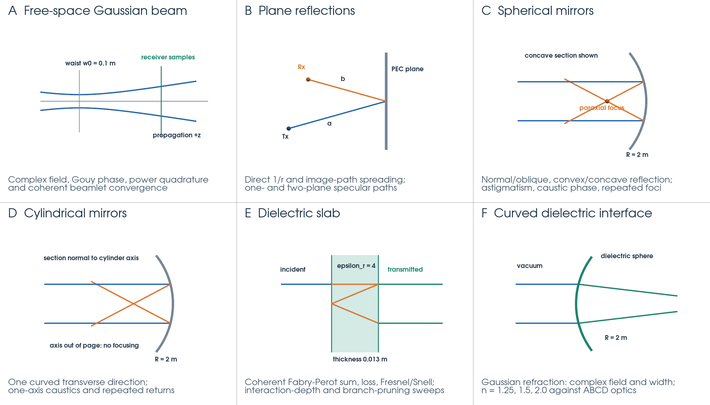
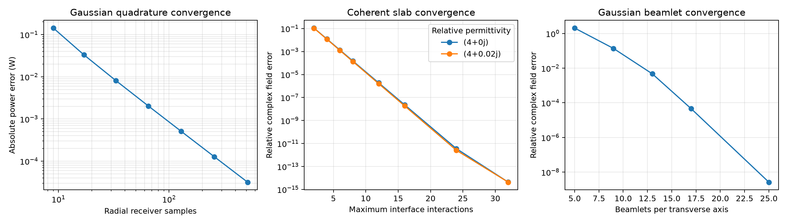

# Numerical benchmarks

These tests validate electromagnetic field accuracy, geometrical spreading,
caustic phase, energy accounting, and convergence against independent analytical
solutions. They exercise the native C++ implementation directly and through the
public Python beam API. They do not measure execution speed.

## Geometry overview



Blue indicates incident rays or the Gaussian envelope, orange reflected paths,
green transmitted paths or receiver sampling, and grey reflecting surfaces.
These are schematic sections, with dimensions annotated rather than drawn to
scale. Panels C and D illustrate concave focusing; the tests also cover convex
mirrors. The slab's round trips are separated vertically for visibility: the
normal-incidence slab tests have collinear paths. The beam envelope is exaggerated.
The figure illustrates the setups, rather than plotting a solver result.

[plot_geometries.py](plot_geometries.py) generates the figure using PyVista/VTK
with off-screen rendering. No interactive window is needed.

## Gaussian-beam transport

[beam_transport.py](beam_transport.py) calls `raytracing.beam.solve` at 10 GHz.
The Gaussian waist radius is 0.1 m, with Rayleigh range
`z_R = k w_0^2 / 2`, approximately 1.048 m in vacuum. Reference fields come from
Gaussian formulas, independent slab series, Fresnel/Snell laws, and paraxial ABCD
optics. Both real and imaginary field components are compared, so a correct
intensity with an incorrect phase fails the field checks.

| Test / geometry | What is varied and checked | Saved CSV in `numerical_audit/beams/` |
| --- | --- | --- |
| Free-space Gaussian (A) | Waist at z = 1 m; 121 axial locations and radii 0, 0.5w, w, 2w. Checks diffraction, transverse envelope, carrier phase and Gouy phase. | [gaussian_field.csv](numerical_audit/beams/gaussian_field.csv) |
| Receiver power (A) | Integrates intensity to radius 5w with 9–513 radial samples. The integral must converge to the independently normalized 1 W source power. | [gaussian_power_convergence.csv](numerical_audit/beams/gaussian_power_convergence.csv) |
| Plane-wave slab (E) | Thickness 0.013 m, relative permittivity 4 or 4 + 0.02i. Increases interaction limit from 2 to 32; compares coherent transmission with the Fabry–Perot sum and checks branch power accounting. | [slab_convergence.csv](numerical_audit/beams/slab_convergence.csv) |
| Finite Gaussian slab (E) | Compares four transverse receiver positions with an independent 40-order sum, including the different Gaussian propagation distance of every round trip. | [gaussian_slab.csv](numerical_audit/beams/gaussian_slab.csv) |
| Branch pruning (E) | Sweeps power cutoff from 1e-2 down to zero at fixed depth 32. Records field error, segment count, and discarded power. | [branch_pruning_convergence.csv](numerical_audit/beams/branch_pruning_convergence.csv) |
| Oblique dielectric interface (E) | Incidence angles 0°, 10°, 30°, 45°, Brewster angle (~63.435°), 70°, 80°, for s and p polarization. Checks Fresnel reflected power, Snell direction and R + T = 1 for index 2. | [fresnel_angles.csv](numerical_audit/beams/fresnel_angles.csv) |
| Concave sphere (C) | Radius 2 m; compares reflected on-axis complex field and width at 100 distances with `1/q_out = 1/q_in - 2/R`. | [concave_mirror.csv](numerical_audit/beams/concave_mirror.csv) |
| Oblique spherical mirror (C) | Angles 0°, 15°, 30°, 45°, 60°. Checks distinct tangential and sagittal curvature changes, 2/(R cos θ) and 2 cos θ/R. | [astigmatic_mirror.csv](numerical_audit/beams/astigmatic_mirror.csv) |
| Repeated spherical/cylindrical mirrors (C, D) | Eight reflections inside radius-2 m PEC surfaces. Checks finite off-axis complex fields and both beam widths against a scalar ABCD recurrence; the cylinder has no focusing power along its axis. | [repeated_gaussian_mirrors.csv](numerical_audit/beams/repeated_gaussian_mirrors.csv) |
| Curved dielectric entry (F) | Radius-2 m sphere, indices 1.25, 1.5, 2.0; 20 distances per index. Checks transmitted complex field and width against the spherical-interface ABCD law. | [gaussian_curved_refraction.csv](numerical_audit/beams/gaussian_curved_refraction.csv) |
| Homogeneous absorption | Plane wave in permittivity 4 + 0.02i, sampled at 80 distances up to 1.99 m. Checks attenuation and phase against `exp(i k n z)`. | [absorption.csv](numerical_audit/beams/absorption.csv) |
| Coherent Gaussian beamlets (A) | 5, 9, 13, 17, 25 beamlets per transverse axis. Checks the coherent field at nine receiver points away from the fitting plane against a single analytical Gaussian. | [beamlet_convergence.csv](numerical_audit/beams/beamlet_convergence.csv) |

The suite contains **23 pass/fail checks**. Its
[summary.json](numerical_audit/beams/summary.json) records each error and tolerance,
the solver version and binary path, Python/platform information, and UTC run time.
Typical complex-field limits are 2e-11 relative error (2e-10 for repeated mirrors).
Fresnel, Snell and energy residual limits are 2e-12. The receiver quadrature has a
4e-5 W absolute-error limit and an error-reduction check; the beamlet field has a
2e-6 relative-error limit and a separate reduction check. Units and error measures
vary by test; the CSV headers and JSON check names identify them.



The plot is generated when Matplotlib is installed. Numerical checks still run
without it. A failed numerical check produces a nonzero exit status after saving
the summary.

## Point-ray spreading and caustics

[test_spreading.cpp](../tests/cpp/test_spreading.cpp) compares the numerical
ray-tube Jacobian with independent geometrical-optics mirror equations. If its
two transverse spreading lengths are B1 and B2, the expected area per solid angle
is `abs(B1 B2)` and field factor is `1 / sqrt(abs(B1 B2))` for the default 1 m
reference distance.

| Test family | Coverage and reference |
| --- | --- |
| Direct and plane paths (B) | Free-space 1/r field, one plane reflection and two-plane image paths. Both transverse lengths equal total unfolded path length. |
| Curved mirrors (C, D) | Normal and oblique convex spheres/cylinders, a concave sphere, and two convex spherical reflections. Ten geometry families each sample 61 receiver distances. Single-reflection lengths are `a+b ± 2ab/(R cos θ)` tangentially and `a+b ± 2ab cos θ/R` sagittally; the cylinder's axial length is `a+b`. Plus denotes convex, minus concave. |
| Rigid transformations | Rotates and translates each geometry to check that spreading and caustic counts do not depend on the world coordinate frame. |
| Caustic phase | Concave spheres and cylinders at 0°, 15°, 30°, with 120 receiver distances per angle. Checks focal multiplicity and reconstructed complex PEC field, including `exp(-i pi mu/2)` for caustic count mu. |
| Repeated foci | One through twelve reflections inside spheres/cylinders, also transformed. Checks two focal directions per spherical return and one per cylindrical return. |
| Diagnostics | Exact receiver caustics must have no finite field factor; checks reference-distance scaling, missed/blocked central rays, aperture-edge perturbations, invalid public solver options, unstable derivatives, and adaptive step reduction around a neighbouring blocker. |
| Finite-difference convergence | Sweeps angular step from 0.02 to 0.000002 radians with adaptive halving disabled. Halving the first step must reduce area error by a factor between 3.5 and 4.5, consistent with second-order central differences. |

The general spreading relative-error limit is 2e-6; the caustic sweep and repeated
focus checks allow 1e-5. Exact focal singularities are checked separately rather
than assigned a finite amplitude. Singular samples in the spreading CSV are
marked `nan`.

Outputs in [numerical_audit/spreading/](numerical_audit/spreading/):

- [spreading.csv](numerical_audit/spreading/spreading.csv): analytical and numerical
  transverse lengths, area, field factor, and relative error by case/distance.
- [caustics.csv](numerical_audit/spreading/caustics.csv): expected/measured focal
  counts and complex-field error for the concave-mirror sweeps.
- [convergence.csv](numerical_audit/spreading/convergence.csv): angular step and area error.
- [summary.txt](numerical_audit/spreading/summary.txt): check count, maximum spreading
  error, and convergence ratio. Diagnostics and repeated-return assertions are
  included in the count but do not have separate CSV rows.

## Reproduce the outputs

Run these commands from the repository root, using an environment with the built
RayTracing Python package and NumPy installed. Matplotlib adds the convergence
plot; PyVista/VTK is required for the geometry illustration. The project's `viz`
extra supplies both plotting packages. On Windows, the existing environment's
interpreter is `.venv/Scripts/python.exe`.

```sh
python benchmarks/beam_transport.py
python benchmarks/plot_geometries.py
```

The beam outputs go to `benchmarks/numerical_audit/beams/` and the illustration
to `benchmarks/figures/geometries.png`, independent of the working directory.
Both scripts accept `--output PATH`. Rerunning replaces their named output files.

For the native benchmark, configure a C++20 Release build with Eigen3 and CMake
4.2+ (on Windows, use the project's MSVC/vcpkg build environment):

```sh
cmake -S . -B build/benchmarks -DCMAKE_BUILD_TYPE=Release -DBUILD_TESTING=ON
cmake --build build/benchmarks --config Release --target test_spreading
ctest --test-dir build/benchmarks -C Release -R "^spreading$" --output-on-failure
```

CTest writes to `benchmarks/numerical_audit/spreading/`. You can also run the
`test_spreading` executable directly with an output directory argument. Its
standalone default remains `analytical-spreading` in the current working directory.
The Python suite is also exercised by
`python -m pytest tests/python/test_analytical_transport.py`, which writes into
pytest's temporary directory.

## Saved results and historical audit

The beam and standalone point-ray benchmarks were rerun on **14 November 2026**
using the installed Python solver (version 1.0.1) and the existing native executable.
All 23 beam checks and 2,716 point-ray checks passed. Maximum spreading relative
error was 1.85075e-6, and the finite-difference convergence ratio was 4.05498.
The native executable was not rebuilt for this output refresh.

[numerical_audit/report.html](numerical_audit/report.html) describes the earlier
October 2026 cleanup audit. Its full-suite counts, old/new comparison, wheel name,
and pre-fix failures refer to that historical run. The retained text logs,
`historical_comparison.json`, `previous_results/`, and `no_viz/` support that audit;
they are not evidence that the full suite was rerun today. The beam and spreading
datasets at the links above are the refreshed results.

`python benchmarks/report_numerical_audit.py` rebuilds the historical report from
the retained evidence. It does not execute tests and deliberately checks the
original audit's expected counts. The HTML incorporates the beam summary currently
in the output folder. Build trees and executables remain under `build/`; report
files, CSVs, figures and supporting logs are retained here in `benchmarks/`.

All tests use SI units and the `exp(-i omega t)` convention. Gaussian transport
assumes paraxial beams, isotropic homogeneous regions and weak loss. Edge diffraction
and aperture clipping are outside this model; geometrical-optics fields at exact
point-ray caustics are undefined and are rejected by the diagnostic checks.
