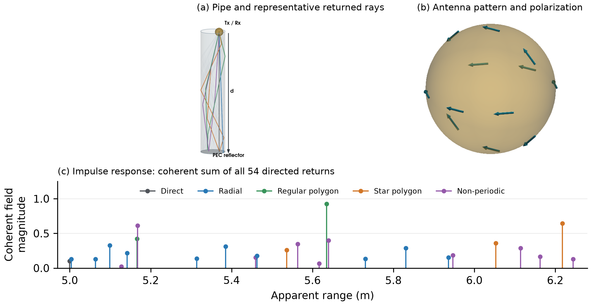

# Circular-pipe radar examples

The reproduction files are maintained on the `reproduce`
branch. Clone that branch before following the commands below:

```sh
git clone --branch reproduce https://github.com/SolverNotConverging/RayTracing.git
cd RayTracing
```

## Interactive case A



This example uses the point-ray solver and PyVista/VTK to reproduce the
manuscript's case A: a PEC pipe of diameter 1 m, a PEC planar reflector 5 m
below the radar, a 0.3 m radar offset, and a 77 GHz carrier. Tx and Rx are
colocated at `(0.3, 0, 5)` m. The reflector lies at world `z = 0`.

From the RayTracing repository, install the library and visualization tools:

```sh
python -m pip install ".[viz]"
python examples/python/circular_pipe.py --verify
```

The VTK window contains the pipe and returned rays, an antenna-pattern view,
and the coherent impulse response. Move the **Delay group** slider to
highlight all directed rays contributing to a peak. The readout gives
its delay, apparent range, multiplicity, magnitude and phase. Drag the
3D views to rotate them and scroll to zoom.

For figures and data without opening a window:

```sh
python examples/python/circular_pipe.py --verify --no-show --output circular_pipe_output
```

## Antenna orientation

Both antennas use `Isotropic(VERTICAL, 1)`. Their field magnitude is one
in every direction, so the magnitude surface is a sphere. The arrows on
that sphere show the direction-dependent transverse polarization computed
by `antenna.farfield`. The sphere's displayed radius is a visualization
scale, not an antenna size or a propagation distance.

The columns of `ORIENTATION` are the local axes expressed in world axes:

```text
local x = -world z
local y =  world y
local z =  world x
```

Thus the local polar axis points along world +x, while the direct return
travels toward world -z. The library evaluates the spherical polarization
in the antenna frame and rotates the resulting vector into world axes.
The same antenna object is used for the simulation and the illustration.

## Returned rays and impulse response

The solver launches 8000 rays and uses an Rx discovery sphere of radius
0.24 m before refining to the point Rx. The PEC reflector is unfolded:
the receiver image is at `(0.3, 0, -5)` m, and the scene contains one exact
analytical cylinder. Up to eight wall reflections are allowed, corresponding
to nine reflections after folding the path back across the reflector.
The displayed response retains paths of total length 10–12.5 m (apparent
range 5–6.25 m). It contains 54 directed returns in 26 delay groups.

This construction also handles a wall hit at the reflector rim as the two
simultaneous PEC reflections. The solver independently discovers the path
and computes its spreading and caustics in the unfolded domain. The image
Rx orientation applies the PEC polarization transformation; no analytical
launch directions or fitted field correction are supplied. The returned
vertices are folded back into the physical pipe for visualization.

`--verify` repeats the calculation with 16000 launches and with an
10-wall-reflection limit (11 including the reflector). It checks one-to-one launch-direction matches,
path lengths and complex coefficients. No analytical ray list is supplied
to the shooting solver. Family labels are inferred from the computed
transverse geometry after solving.

Each impulse tap is the **complex sum** of the directed coefficients at
that delay; the plot shows the magnitude of this sum. All 54 paths enter
the CIR. The static geometry figure highlights one representative per
family plus the direct ray, with the other paths faintly visible.
There is no pulse convolution or fitted gain, phase or delay.

RayTracing uses `exp(-i omega t)`. The manuscript uses the opposite time
convention, so its complex coefficients are the conjugates of the native
ones; tap magnitudes and delays are unchanged.

## Exports

- `circular_pipe.png/pdf`: scene, antenna pattern and coherent CIR.
- `circular_pipe_geometry.png/pdf`: manuscript geometry illustration.
- `impulse_response.npz`: delays, apparent ranges, multiplicities, native
  coefficients and coefficients in the manuscript convention.
- `paths.csv` and `paths.json`: ray labels, delays, fields and vertices.
- `antenna_pattern.vtp` and `returned_paths.vtm`: VTK data for inspection
  in ParaView or PyVista; keep the companion `returned_paths` folder.
- `manifest.json`: parameters, software versions, script hash and
  convergence-check results.

```python
import numpy as np
data = np.load("circular_pipe_output/impulse_response.npz")
delay_ns = data["delay_s"] * 1e9
magnitude = np.abs(data["coefficients_native"])
print(np.column_stack([delay_ns, magnitude, data["multiplicity"]]))
```

## Reproduce the twelve manuscript configurations

[circular_pipe_validation.py](circular_pipe_validation.py) runs fresh, unseeded
point-ray SBR solves and compares the directed complex coefficients with the
archived analytical predictions for the twelve configurations reported in the manuscript. It requires only the
installed RayTracing package and NumPy; no CST files or visualization libraries
are needed. The propagation scene uses an analytical cylinder and the exact
PEC-reflector image construction, with normals computed from the cylinder.
Polygonal meshes are used only for visualization.

From the repository root:

```sh
python -m pip install .
# Quick examples: two depths and two radar offsets.
python examples/python/circular_pipe_validation.py --cases A B D --verify
# Every manuscript configuration, including high reflection orders.
python examples/python/circular_pipe_validation.py --all --verify --output pipe_all
# One selected configuration.
python examples/python/circular_pipe_validation.py --cases L --verify --output pipe_L
```

The twelve cases span depths 5–40 m and offsets 0.02–0.3 m. All use diameter
1 m, 77 GHz, unit-magnitude omnidirectional vector antennas,
and retain path lengths between 2d and 2.5d. The table lists the wall-reflection
limit in the unfolded scene; the folded physical path also meets the planar
reflector once. Larger cases require substantially more ray launches.

| Case | Depth d (m) | Offset a (m) | Directed paths | Launches | Wall-reflection limit |
| --- | ---: | ---: | ---: | ---: | ---: |
| A | 5 | 0.3 | 54 | 8000 | 8 |
| B | 10 | 0.3 | 212 | 32000 | 16 |
| C | 20 | 0.3 | 863 | 128000 | 37 |
| D | 5 | 0.1 | 22 | 2000 | 7 |
| E | 10 | 0.1 | 69 | 8000 | 15 |
| F | 5 | 0.05 | 21 | 2000 | 7 |
| G | 20 | 0.1 | 248 | 32000 | 30 |
| H | 10 | 0.02 | 44 | 32000 | 15 |
| I | 20 | 0.02 | 92 | 64000 | 30 |
| J | 30 | 0.02 | 165 | 1024000 | 45 |
| K | 40 | 0.1 | 950 | 4096000 | 60 |
| L | 40 | 0.02 | 252 | 2048000 | 60 |

`--verify` repeats each solve with twice as many launches, then with two more
allowed reflections. Each repeat must recover the reference path count and
complex-field multiset and match the base run one-to-one by launch direction.
The path-length tolerance is 1e-8 m; relative complex-field tolerance is 1e-4,
with a denominator floor of 1e-8 times the largest analytical coefficient.
Missing paths, duplicates, non-finite results or excess errors fail the run.
The reference comparison matches wall order, delay and complex field because
the archived CSVs do not contain launch directions. It does not seed ray discovery.

Outputs include a fresh `summary.json`, per-case `matched_paths.json`, and
`impulse_response.npz` with coherent complex taps in both time conventions.
The summary records the run time, script and solver-binary hashes, reference
hashes, error measures, and convergence checks. Failure details and completed
case results remain in the summary if a later case fails.

### Analytical-reference provenance

[circular_pipe_reference/cases.json](circular_pipe_reference/cases.json) records
the source paths, hashes and verification date of the twelve-case analytical
comparison in [RayTracingPipe](https://github.com/SolverNotConverging/RayTracingPipe).
The CSVs are frozen reference data from that completed study, not results generated
by this example. The runner uses their `theory_real`, `theory_imag`, `delay_ns`
and `wall_reflections` columns. The archived native columns are retained for
provenance but are not used as reference fields. It recomputes the SBR side;
recomputing the analytical side requires the manuscript repository's
`pipe_solver` and `Manuscript/Revised_Manuscript/experiments` scripts.

The manuscript's comparison reports 2992 directed paths, maximum relative
complex-coefficient discrepancy 2.12329e-06, and maximum path-length discrepancy
1.42109e-13 m. The tolerances above allow numerical differences across builds.
A separate [example verification summary](circular_pipe_reference/validation_summary.json)
records the fresh verification of this example against those reference fields.
Reported single-run durations are diagnostics, not a reproduction of the paper's
five-call median speedup benchmark.

For independent mirror, spreading, caustic and dielectric-interface checks of
the underlying solver, see the [numerical benchmarks](../../benchmarks/README.md).

The PEC image adapter also has direct checks of vector polarization, radial
corner reflection, and agreement with the physical cylinder-and-disk scene
for smooth returns:

```sh
python examples/python/check_pec_circular_return.py
```
